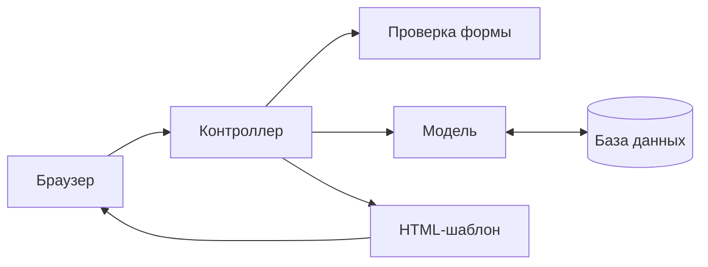
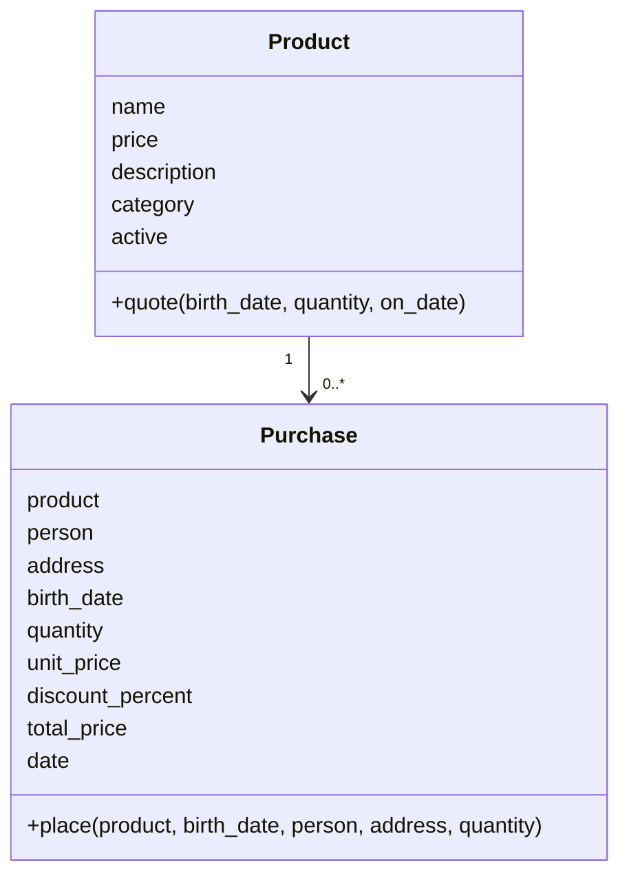

# Лабораторные № 2–3 · Магазин «Линия» · Вариант 9

Учебный MVC-магазин канцелярских товаров на Django.
Автор: Артём Плешаков. Дисциплина: Технологии программирования.

## Возможности

- Простой каталог из шести товаров без изображений.
- Кнопка «Купить» открывает форму: получатель, дата рождения, адрес, количество.
- Покупка без регистрации. В день рождения скидка 10% на любой товар.
- «Пересчитать» показывает сумму без создания заказа.
- «Оформить заказ» сохраняет покупку и открывает чек.
- Чек доступен в той же сессии браузера; обновление чека не повторяет покупку.
- Админка Django для товаров и просмотра заказов.
- Тесты, GitHub Actions, Docker и локальная автоматическая доставка.

## Запуск через PyCharm / терминал

Из папки `Lab23/PTLab2`, используя общее окружение `ТП/.venv`:

```powershell
..\..\.venv\Scripts\python.exe -m pip install -r requirements-dev.txt
..\..\.venv\Scripts\python.exe manage.py migrate
..\..\.venv\Scripts\python.exe manage.py bootstrap_demo
..\..\.venv\Scripts\python.exe manage.py runserver
```

Открыть http://127.0.0.1:8000/.
Для другого порта: `manage.py runserver 8001`.
База SQLite создаётся локально. Файл `.env` при таком запуске не читается.

Админка: http://127.0.0.1:8000/admin/.
Для новой базы создайте администратора командой `manage.py createsuperuser`.
Вход администратора нужен только для управления магазином.

## Запуск через Docker

Скопируйте `.env.example` в `.env`, задайте пароли и `DJANGO_SECRET_KEY`.
При работающем Docker Desktop из этой папки:

```powershell
docker compose up -d --build --wait
docker compose ps
docker compose logs --tail 50 web
```

Магазин: http://localhost:8000/. PostgreSQL хранит данные в Docker volume.
Остановка: `docker compose stop`, повторный запуск: `docker compose start`.
После изменения кода повторите команду с `--build`.
Каталог и администратор создаются при первом запуске;
повторный запуск не сбрасывает цены и пароль.

## MVC и правила варианта

Модель — `shop/models.py`, контроллер — `shop/controllers.py`,
маршруты — `shop/urls.py`, представление — HTML-шаблоны и CSS.
Форма в `shop/forms.py` проверяет пользовательский ввод.





Сравниваются день и месяц рождения с датой сервера в `Europe/Moscow`.
При совпадении скидка 10%, иначе 0%. Для 29 февраля скидка действует
29 февраля високосного года. Дата рождения вводится при покупке:
подтверждение документами в учебной работе не реализовано.

Количество: 1–99. Дата рождения: от 01.01.1900 до сегодня.
Деньги рассчитываются через Decimal с округлением ROUND_HALF_UP до копеек.
Две ручки по 120 ₽ в день рождения стоят 216 ₽, в обычный день — 240 ₽.

Цена и скидка вычисляются сервером. В заказе сохраняются дата рождения,
цена, скидка и итоговая сумма. Изменение цены товара не меняет старый чек.
Создание заказа выполняется в транзакции; проданный товар нельзя удалить.
Заказы в админке доступны только для просмотра.

Миграция `0003_guest_checkout` удаляет профили покупателей и связь с ними.
Существующие заказы, сохранённые цены и пользователи админки остаются в базе.
История заказов и страницы регистрации/входа покупателей удалены.

## Лабораторная № 3: проверки

```powershell
..\..\.venv\Scripts\python.exe -m pycodestyle shop tplab2 --exclude=migrations
..\..\.venv\Scripts\python.exe manage.py check
..\..\.venv\Scripts\python.exe manage.py makemigrations --check --dry-run
..\..\.venv\Scripts\python.exe -m coverage run manage.py test shop.tests -v 2
..\..\.venv\Scripts\python.exe -m coverage report
..\..\.venv\Scripts\python.exe -m coverage html
```

26 тестов и дополнительные сценарии через subTest.
Проверяются календарные границы скидки, округление, ограничения БД,
покупка без аккаунта, пересчёт без сохранения, валидация, CSRF, доступ
к чекам, экранирование, подмена цены и начальная загрузка.
Покрытие кода магазина: 100% строк и ветвлений, без миграций и тестов.
Порог в CI — 95%. Отчёт: `htmlcov/index.html`.

## CI/CD

`.github/workflows/ci-cd.yml` проверяет Python 3.11/3.12/3.13 с PostgreSQL 16:
PEP8, Django check, миграции, тесты и покрытие.
После успешного push в master собирается Docker-образ
`ghcr.io/asartem9855/ptlab2:<SHA>` и артефакт `lab23-deployment`.

Автоматическое локальное обновление:

```powershell
node scripts/deploy-agent.mjs --watch
```

Нужны Node.js, GitHub CLI с выполненным `gh auth login`, Docker Desktop.
Агент устанавливает проверенную вершину master, выполняет миграции и healthcheck.
Для разового обновления: `node scripts/deploy-agent.mjs --once`.
Остановка агента: Ctrl+C. Состояние и журнал находятся в `.deploy/`.
При работе над локальными изменениями используйте запуск из исходников:
агент разворачивает версию из GitHub.

## Что показать преподавателю

1. Каталог и кнопку «Купить».
2. Две ручки по 120 ₽ с сегодняшними днём/месяцем рождения: итог 216 ₽.
3. Пересчёт с другой датой рождения: итог 240 ₽.
4. Оформление заказа, чек и сохранённую запись в админке.
5. MVC-код, тесты, отчёт покрытия и GitHub Actions.

Исходная заготовка: [kpdvstu/PTLab2](https://github.com/kpdvstu/PTLab2).
Методичка: «ТП_Лаб_2_MVC_TravisCI_Heroku.pdf», вариант 9.
Лицензия: MIT, см. `LICENSE`.
