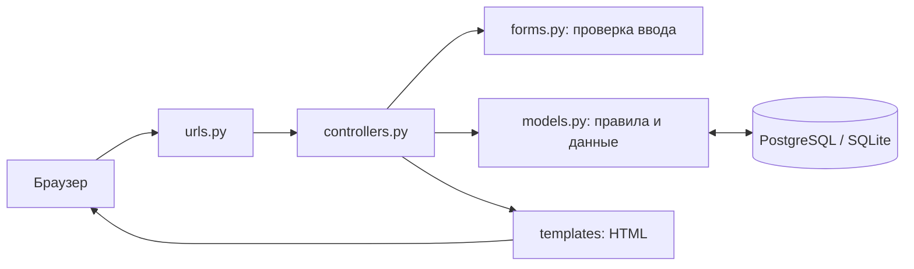
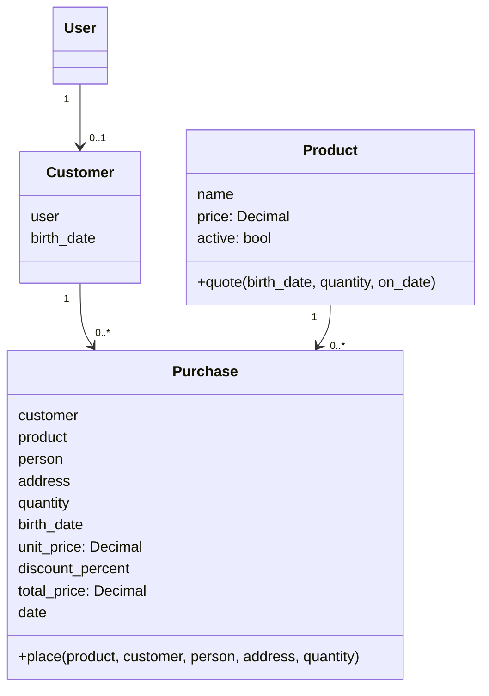

# Лабораторные № 2–3 · Магазин «Линия» · Вариант 9

[](https://github.com/asartem9855/PTLab2/actions/workflows/ci-cd.yml)

**Дисциплина:** Технологии программирования. **Автор:** Артём Плешаков.

## Задание

ЛР № 2: MVC-приложение магазина канцелярских товаров. Покупатель получает
**скидку 10% на любой товар в свой день рождения**. ЛР № 3: unit-тесты
и интеграционные проверки приложения, автоматическое тестирование и доставка.
Heroku и Travis CI не используются. Есть суперпользователь и админка.

## Что реализовано

- Каталог шести канцелярских товаров, поиск, цены с копейками, адаптивный интерфейс.
- Регистрация, вход/выход и профиль с датой рождения.
- Оформление покупки, выбор количества, предварительный расчёт суммы.
- Скидка автоматически появляется в каталоге и заказе в день рождения.
- Чек и история собственных заказов; чужой чек недоступен.
- Администрирование товаров, покупателей, пользователей и просмотр заказов.
- Миграции, фикстура канцтоваров и идемпотентная команда `bootstrap_demo`.
- GitHub Actions, PostgreSQL, Docker, Gunicorn, отчёты покрытия и сборка образа.

## MVC

Django использует собственные названия MTV; распределение ответственности
в этой работе соответствует MVC. **Модель** — `shop/models.py`, **контроллер** —
`shop/controllers.py` и маршрутизатор `shop/urls.py`, **представление** —
HTML в `shop/templates/` и CSS в `shop/static/`. Это серверное приложение:
контроллер получает HTTP-запрос, проверяет форму, вызывает модель и выбирает HTML.
Расчёт скидки не находится в шаблоне или клиентском JavaScript.





## Правила варианта 9

Сравниваются день и месяц рождения с текущей датой сервера в `Europe/Moscow`.
Год рождения не участвует. При совпадении скидка 10%, иначе 0%.
Для родившегося 29 февраля скидка действует 29 февраля високосного года;
перенос на 28 февраля/1 марта не задан методичкой и не применяется.

`итого = ROUND_HALF_UP(цена × количество × (100 − скидка) / 100, 2)`.
Округляется итог всей позиции до копеек. Пример: 2 ручки по 120 ₽ в день
рождения → 240 − 24 = **216 ₽**; в обычный день → **240 ₽**.
Количество 1–99, цена больше нуля, дата рождения от 01.01.1900 до сегодня.
Дата рождения берётся из профиля, а не из формы заказа. Менять её может
администратор. В учебном проекте документальное подтверждение даты не реализовано.

В заказ сохраняются снимки даты рождения, цены, скидки и суммы. Изменение
товара или профиля не меняет историю. Клиентские поля цены/скидки игнорируются.
Создание заказа выполняется в транзакции, актуальный товар читается с блокировкой.
Проданный товар и покупателя с заказами нельзя удалить. Заказы в админке доступны
только для просмотра. Новая покупка после отправки формы ведёт на отдельный чек
(Post/Redirect/Get), обновление страницы чека не создаёт повторную покупку.

## Быстрый запуск на этом компьютере

Из `Lab23/PTLab2` при работающем Docker Desktop:

```powershell
docker compose up -d --build --wait
```

Магазин: **http://localhost:8000/**. Админка: **http://localhost:8000/admin/**.
Логин суперпользователя — `admin`; его случайный пароль и пароль покупателя
`birthday_demo` сохранены только локально в `.local-credentials.txt`.
У `birthday_demo` день рождения установлен на день первого запуска.
В следующие дни для демонстрации можно изменить его дату через админку.

```powershell
docker compose ps
docker compose logs --tail 50 web
docker compose stop
docker compose start
```

PostgreSQL хранит данные в Docker volume `tp-stationery_postgres_data`.
Обычная остановка контейнеров сохраняет заказы и пользователей.

## Запуск после клонирования

Скопируйте `.env.example` в `.env` и задайте собственные случайные значения
паролей и `DJANGO_SECRET_KEY`. Затем `docker compose up -d --build --wait`.
Начальная загрузка создаст каталог и администратора; повторный запуск не
сбрасывает изменённые цены или пароли. Секреты, база и отчёты исключены из Git
и Docker build context. `.env` применяется Docker Compose; Django сам этот
файл при обычном `runserver` не читает.

### Без Docker, через PyCharm

Общий интерпретатор этого рабочего каталога: `ТП/.venv/Scripts/python.exe`.
Из `Lab23/PTLab2`:

```powershell
..\..\.venv\Scripts\python.exe -m pip install -r requirements-dev.txt
..\..\.venv\Scripts\python.exe manage.py migrate
..\..\.venv\Scripts\python.exe manage.py bootstrap_demo
..\..\.venv\Scripts\python.exe manage.py createsuperuser
..\..\.venv\Scripts\python.exe manage.py runserver
```

В локальной SQLite-базе этого компьютера администратор уже создан;
`createsuperuser` нужен только при новой установке. При занятом порте используйте
`runserver 8001`. Docker и локальный `runserver` используют разные базы данных.
Для PostgreSQL без Docker задайте переменные `POSTGRES_HOST`, `POSTGRES_DB`,
`POSTGRES_USER`, `POSTGRES_PASSWORD`, при необходимости `POSTGRES_PORT`.
Альтернативный способ начальной загрузки каталога: `manage.py loaddata products.yaml`
(использовать на пустой базе; фикстура перезаписывает товары с указанными ID).

## Лабораторная № 3: тесты

```powershell
..\..\.venv\Scripts\python.exe -m pycodestyle shop tplab2 --exclude=migrations
..\..\.venv\Scripts\python.exe manage.py makemigrations --check --dry-run
..\..\.venv\Scripts\python.exe -m coverage run manage.py test shop.tests -v 2
..\..\.venv\Scripts\python.exe -m coverage report
..\..\.venv\Scripts\python.exe -m coverage html
```

| Файл | Что проверяется |
|---|---|
| `test_models.py` | Скидка, календарные границы, 29 февраля, Decimal, округление, количество, снимки цен, ограничения БД |
| `test_controllers.py` | Каталог, поиск, регистрация, авторизация, покупка, чек, права, CSRF, экранирование, подмена цены, health |
| `test_bootstrap.py` | Повторная инициализация, создание суперпользователя, сохранение пароля, запрет повышения чужого аккаунта |

29 тестовых методов, дополнительно параметризованные сценарии через `subTest`.
`BirthdayRuleTests` — unit-тесты без базы. Тесты моделей проверяют ORM и БД,
тесты контроллеров — интеграцию HTTP, форм, шаблонов и моделей.
Тестовая БД создаётся отдельно и удаляется после запуска. Даты фиксируются mock,
поэтому тесты проходят в любой день года. Используются `django.test`/`unittest`
и `coverage.py`, порог покрытия 95%. Измеренное покрытие приложения — 100%
строк и ветвлений; миграции и сами тесты в метрику не включаются.
Это не означает проверку всех возможных состояний. HTML-отчёт: `htmlcov/index.html`.

## CI и доставка

`.github/workflows/ci-cd.yml`: push/PR → Python 3.11/3.12/3.13 и PostgreSQL 16 →
PEP8 → Django check → проверка миграций → тесты → покрытие. После успеха в
`master` собирается Docker-образ и публикуется в
`ghcr.io/asartem9855/ptlab2:<SHA>` и `:latest`. Артефакт `lab23-deployment`
содержит конфигурацию запуска. При ошибке тестов этап доставки не запускается.
Развёртывание на компьютере выполняется Docker Compose, без Heroku.
Образ не содержит базу пользователей или пароли. Доступность GHCR-образа
зависит от настроек пакета; локальная сборка из репозитория не требует GHCR.

## Что показать преподавателю

1. Каталог и регистрацию нового покупателя с сегодняшними днём/месяцем рождения.
2. Товар «Ручка гелевая»: 120 ₽ → 108 ₽; заказ 2 штук → 216 ₽.
3. Обычного покупателя с другим днём рождения: скидки нет.
4. Чек, историю заказов и запись с сохранённой скидкой в админке.
5. `models.py`, `controllers.py`, HTML-шаблоны и диаграммы MVC.
6. Тесты, HTML покрытия и зелёный запуск GitHub Actions.
7. Docker Compose и endpoint `/health/` с ответом `{"status":"ok"}`.

## Выводы и теория

MVC разделяет данные и бизнес-правила, обработку запросов и представление.
Контроллер не рассчитывает скидку: правило инкапсулировано в модели и проверяется
без браузера. Снимки денежных значений обеспечивают воспроизводимость истории.
Модульные тесты дополняются интеграционными, а CI проверяет приложение на чистом
окружении с PostgreSQL. Контейнер и конфигурация обеспечивают повторяемый запуск.

Аналогичные MVC-фреймворки: ASP.NET Core MVC, Spring MVC, Ruby on Rails.
CI отвечает за автоматические проверки интеграции. Continuous delivery готовит
проверенный релиз, continuous deployment автоматически устанавливает его в
целевую среду. Миграции и проверка здоровья входят в процедуру развёртывания.

## Источники и лицензия

Исходная учебная заготовка: [kpdvstu/PTLab2](https://github.com/kpdvstu/PTLab2),
методичка «ТП_Лаб_2_MVC_TravisCI_Heroku.pdf» (2021), с. 5–6.
Собственная реализация и дополнения распространяются по MIT (`LICENSE`).
[Django 5.2 LTS](https://docs.djangoproject.com/en/5.2/releases/5.2/),
[объяснение MVC/MTV авторами Django](https://docs.djangoproject.com/en/5.2/faq/general/),
[тестирование Django](https://docs.djangoproject.com/en/5.2/topics/testing/),
[GitHub Actions](https://docs.github.com/en/actions),
[Docker Compose](https://docs.docker.com/compose/).
